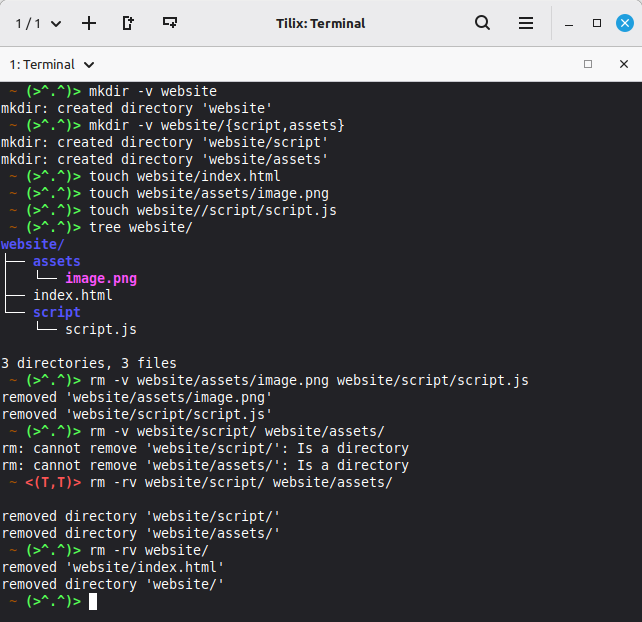
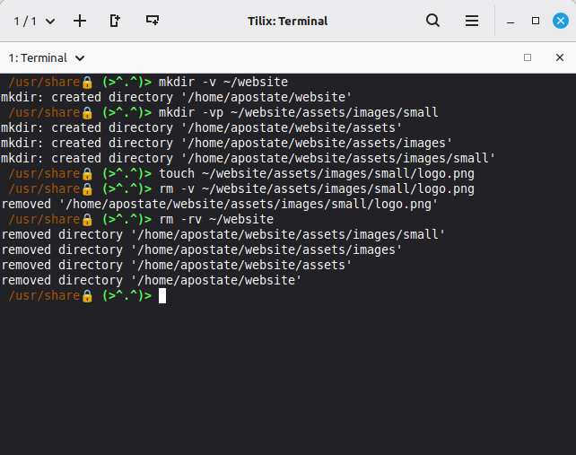
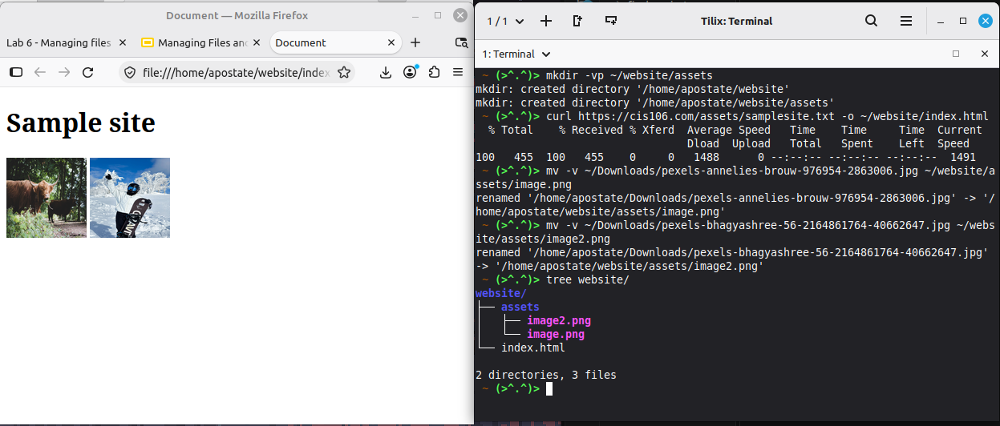
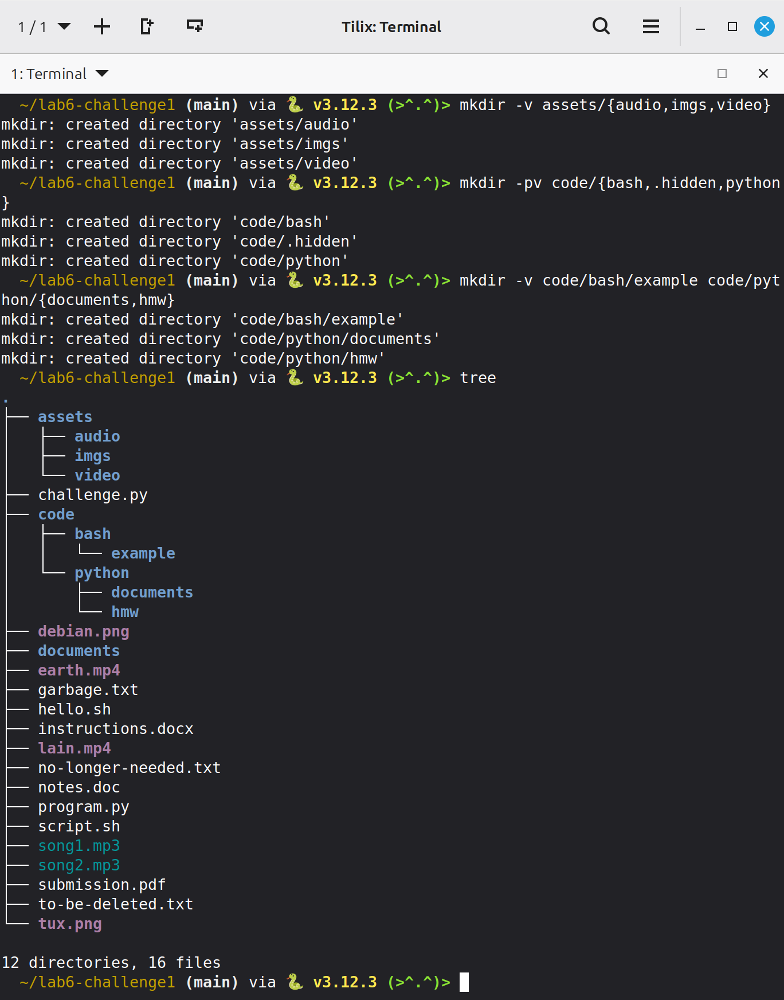
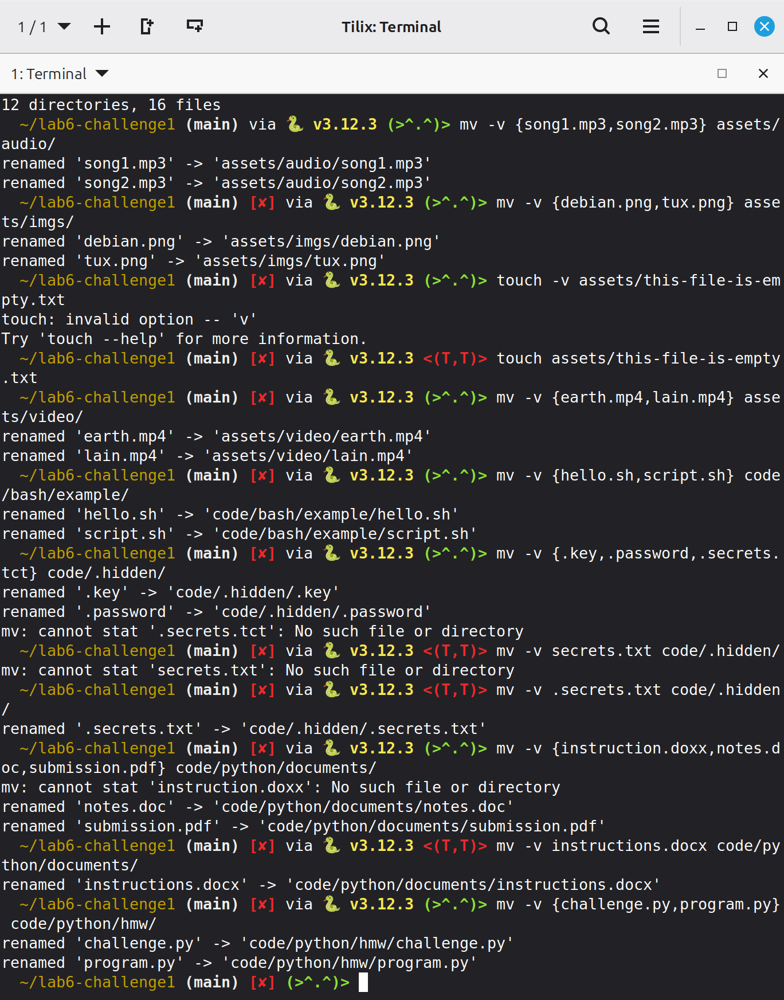
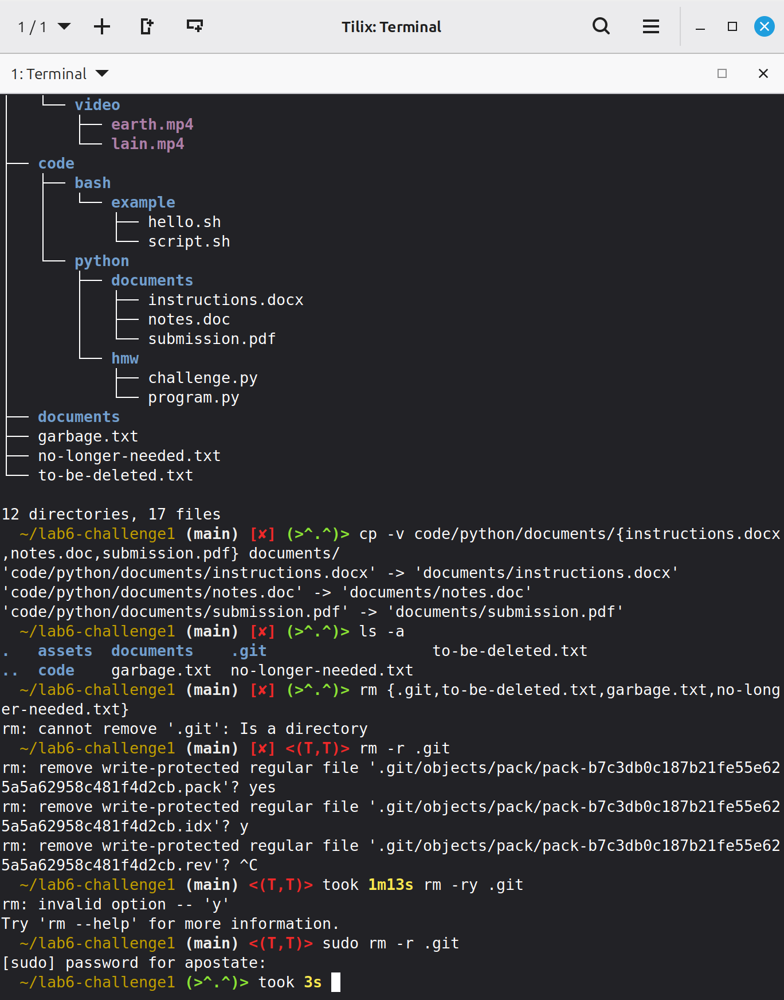
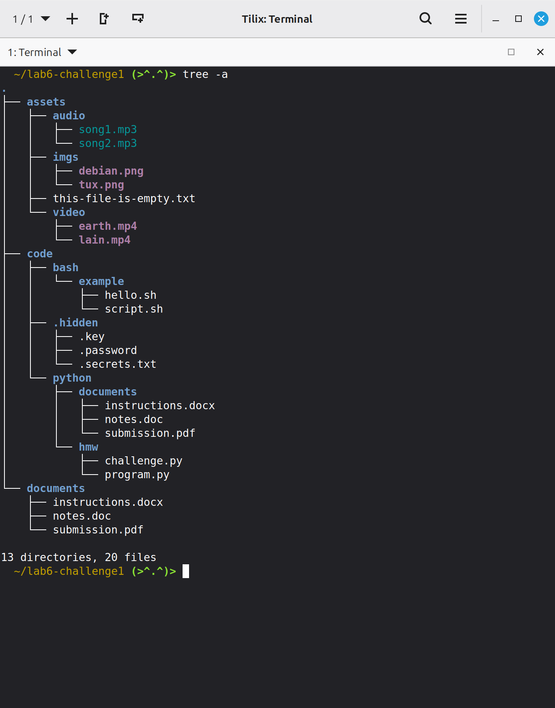
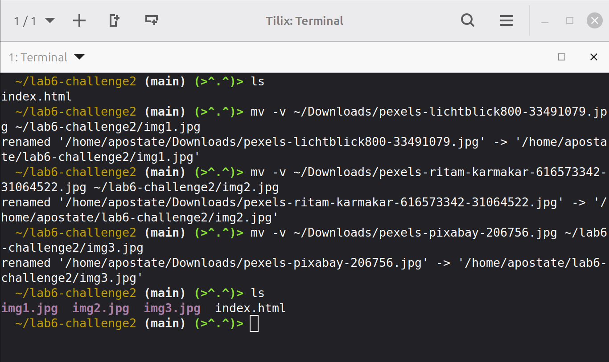
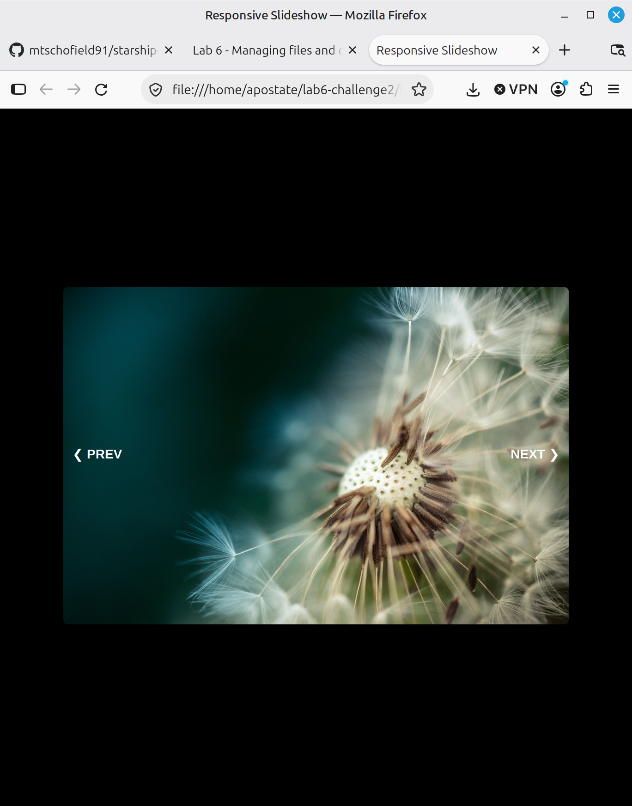

# Lab 6 Submission

## Practice Questions

### Practice Question 1:

### Practice Question 2:

### Practice Question 3:

## Challenge Questions:

### Challenge Question 1;

**Creating the Directories**

**Moving Files**

**Removing Junk Files**

**Final Tree**

### Challenge Question 2:

**Commands Used**

**Power Point w/ Images**

