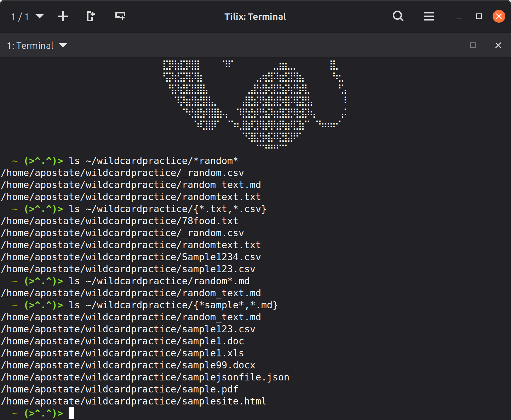
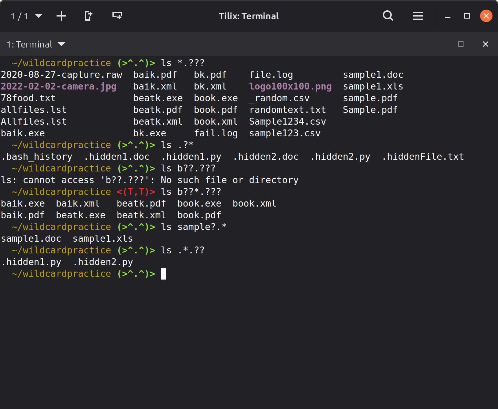
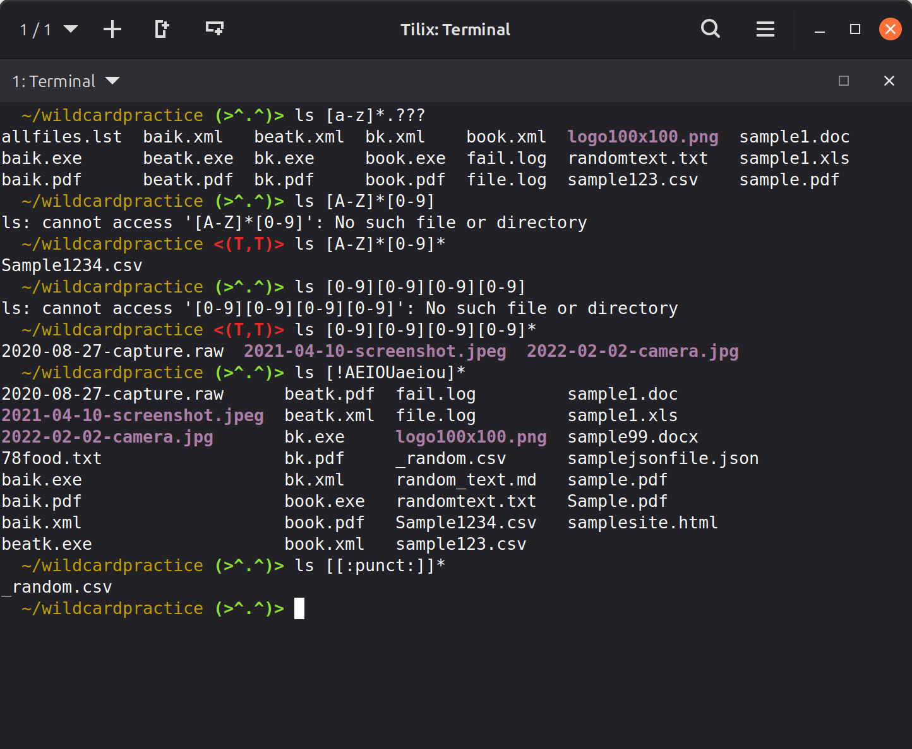
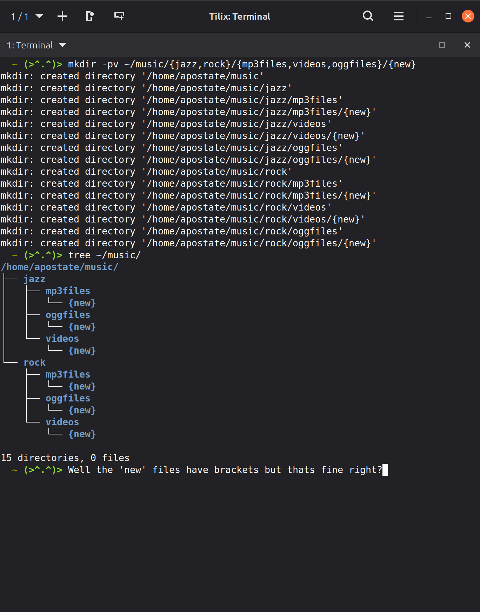
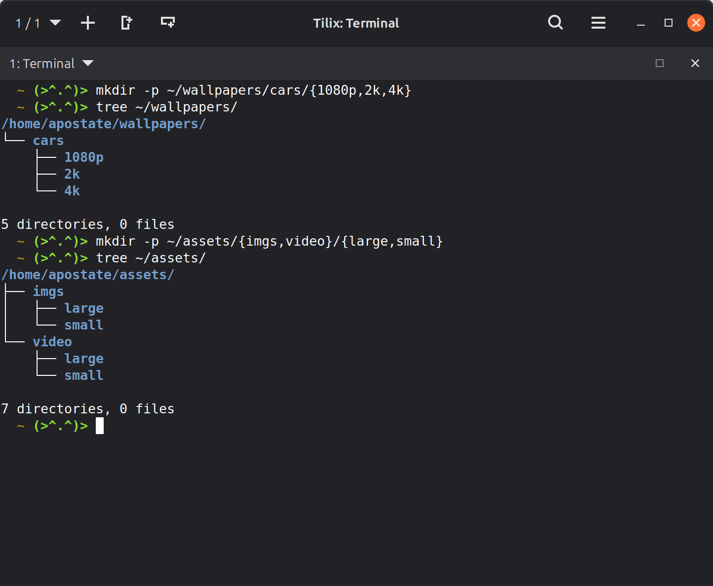
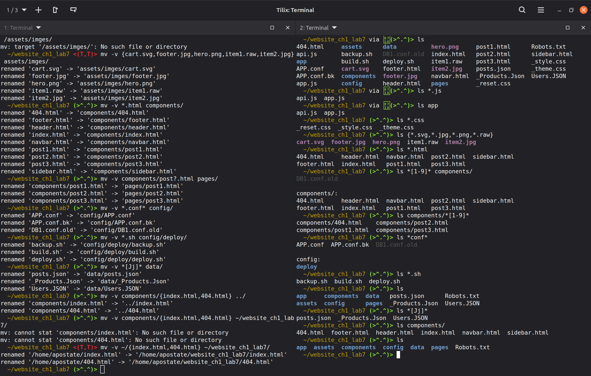
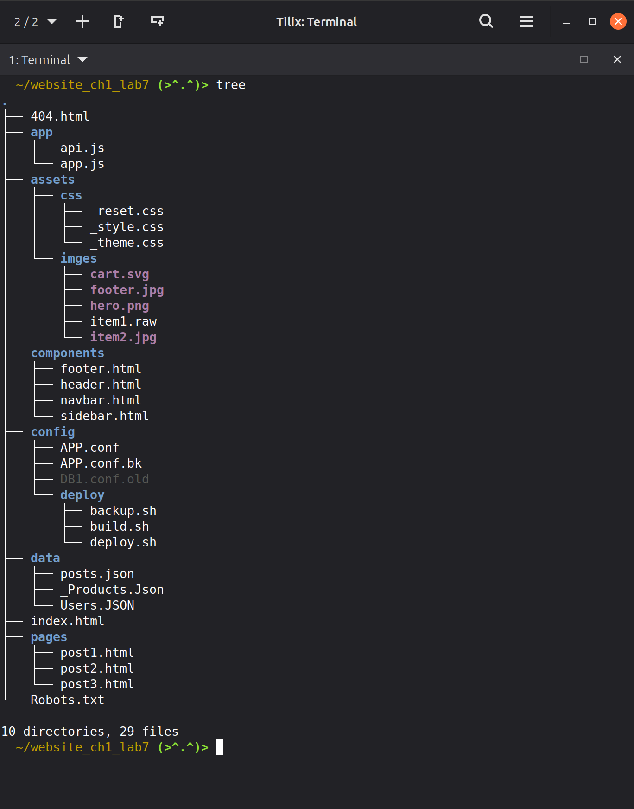

# Lab 7 Submission

## Question 1: Practice

### Practice 1: The ```*``` Wildcard



### Practice 2: The ```?``` Wildcard



### Practice 3: The ```[SET]``` Wildcard



### Practice 4: Brace Expansion



## Question 2: Challenge 1



## Question 3: Challenge 2





