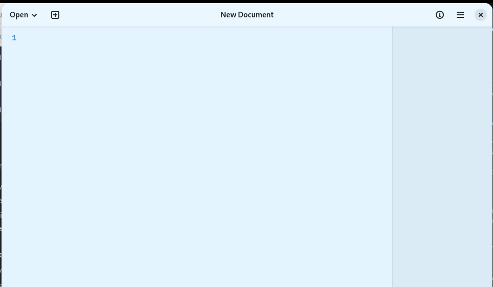
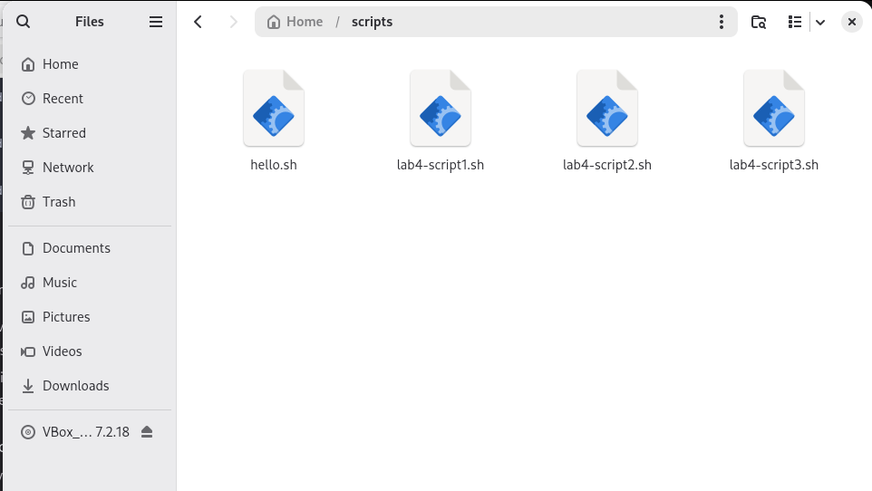
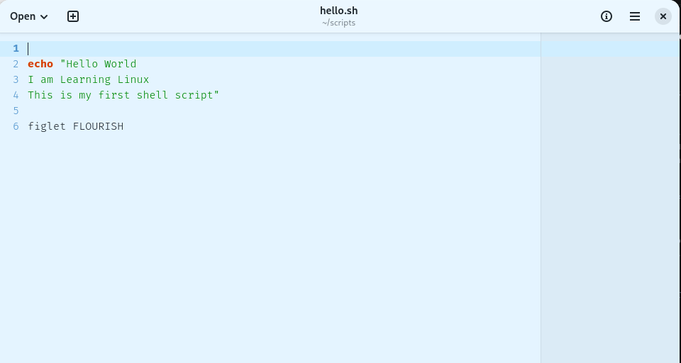
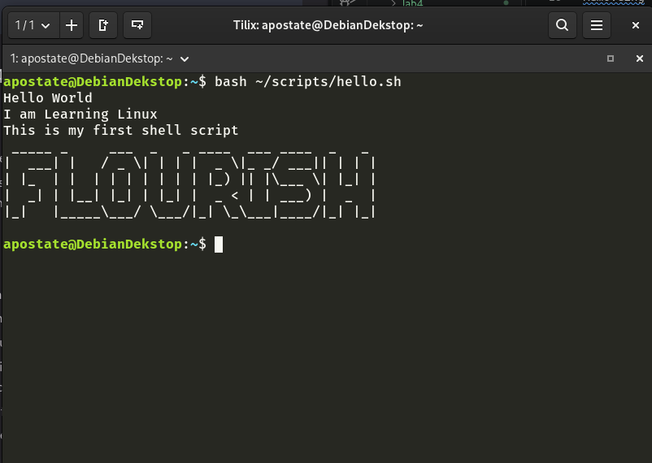

# Notes 4

## Question 1:

Installing and removing software is quite easy with the **apt** command. Theres a few steps to make sure you have the right software.
```bash
apt search <software name>
```
Once you have found the correct program, it must be installed. While searching does not require any special privleges, installing does. therefore the **sudo** command is needed.

```bash
sudo apt install <software name>
```
It will ask for your user password. **DO NOT BE ALARMED IF YOU CANNOT SEE YOUR PASSWORD, IT DOES NOT SHOW**. Inspect the info it gives you back, it gives you a breif summary of whats happening when you confirm execution. Confirm or Abort with **Y/N**

Removeing is just as simple. If the program is already installed on your system you use the **remove** command, as well as the **sudo** command mentioned above.

```bash
sudo apt remove <software name>
```
You will once again be prompted for a **Y/N** confirmation. This will delete the majority of the software. To do a complete removal, you must use the **purge** command.

```bash
sudo apt purge <software name>
```


## Question 2

Writing a shell script is relatively straight forward as well. The first, and arguably one of the more important steps is the title of the file you save. But first, open a simple **Text Editor**



Next, save the file with whatever name you will remember, and change the file type from **.txt** to **.sh**.



Once you have the script saved and converted to a **.sh** file, you are ready to write your script. The text editor works much like any other codeing shells. Type your commands you would like to be executed.



Once you have your script set up the way you want to run, you can run it in your shell. use the following command:

```bash
bash ~/wherever/you/saved/it.sh
```

You'll know you saved it and wrote it correctly if your terminal spits out what you wanted.




