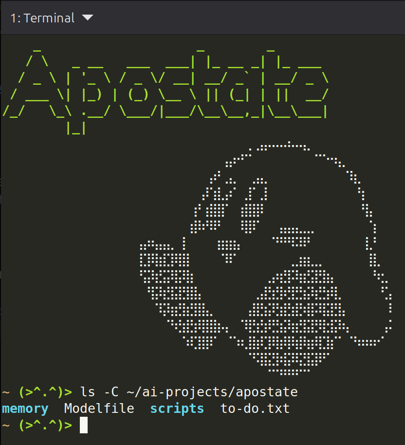
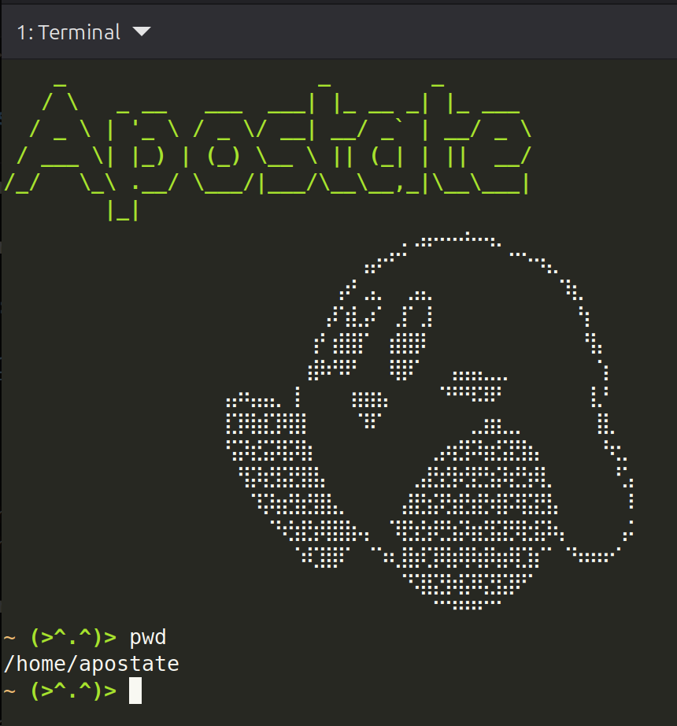
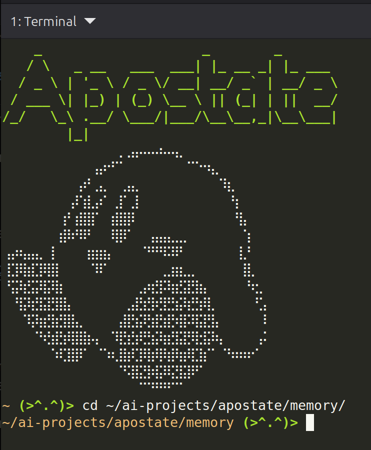

# Notes 5

## Definitions, Usage/Formula, Examples

### ls

The linux command `ls` is a handy way to display a list of the contents of a directory. It can be used with various options to modify the list itself as well.

The syntax and structure is:
```bash
ls [option] [desired path to inspect]
```
Here's an example:



### pwd

The linux command `pwd` is one of the more common commands. It prints whatever the current working directory is, or in other words it tells you which directory you are currently in.

The syntax and structure is:
```bash
pwd [option]
```
Here is an example:



### cd

The linux command `cd` is another very common command. It is the command used to change from which directory you are currently within, or move back to `/home/usr`.

The syntax and structure is:
```bash
cd [path to desired directory]
```
Here is an example:



## Questions:

### What is a variable?

A variable is a named storage location that allows the user to temporarily assign a value to store for later use/reference.

### How do I use a variable?

To use a variable, you must first must declare it with an assignment statement, usually `=`. Once declared, you must use it in a script/program/command, to return the value stored.

### What is an environment variable?

An environment variable is a variable that is used to store configuration data of the systems environment such as:
* HOME - Stores the path to /home directory.
* USER - Stores the current user name.
  
### What is a user defined variable?

A user defined variable is a variable chosen and set by the user or programmer.

### What is the root directory?

The root directory is the top level directory in linux, the parent directory of all other directories.

### What does a "Parent Directory" mean?

A parent directory is the directory that another directory is located. It is the directory one level above the child directory.

### What does "current working directory" mean?

Current working directory means the current directory that your computer is looking at, or the directory that you are within.

### What is an absolute path?

An absolute path is the exact path from the root to a directory, like directions.

Example:
```bash
/home/apostate/cis106/notes
```
Root starts the path with `/` and finishes with a specific directory `/notes`

### What is a relative path?

A relative path is a path that uses your current working directory to complete a path rather then starting at root.

Example: Using the example above, lets say we were in my user directory.
```bash
cis106/notes
```
This would be the relative path to my notes directory.

### What is the difference between "your home directory" and "the home directory"?

The difference between "your home directory" and "THE home directory" is they are different locations.
* Your Home Directory - `/home/apostate` would be my home directory. It is the user folder, each user having their own user directory.
* The home directory - Is `/home`. This is where all the user directories are stored, the parent directory to the user home directories.


