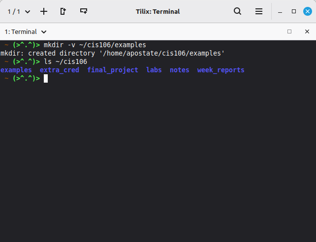
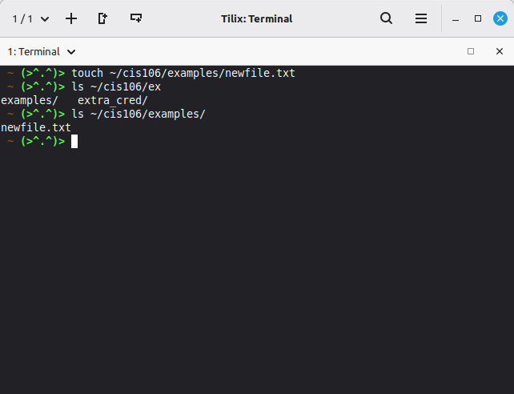
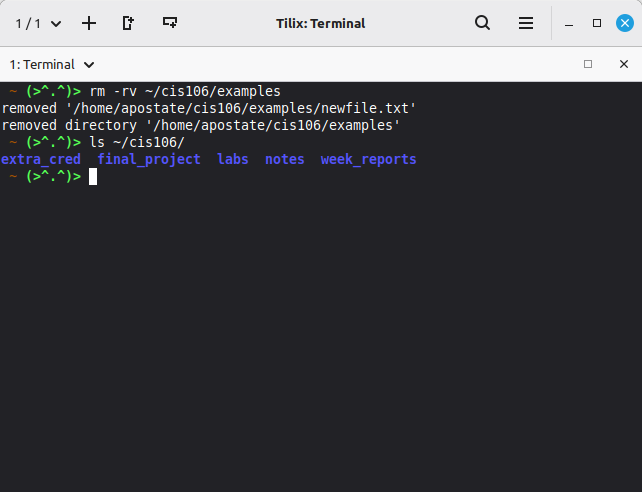
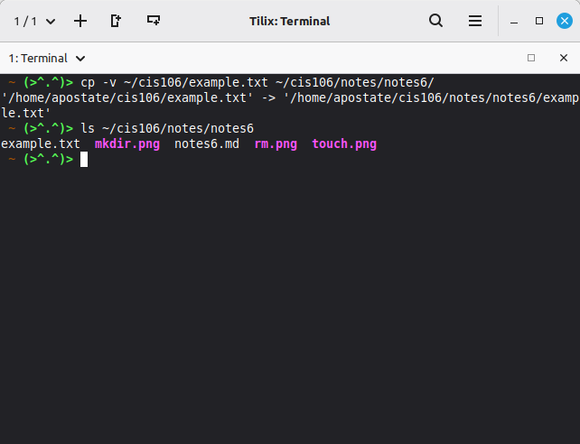
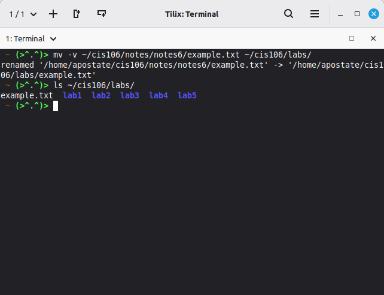

# Notes 6 Submission

## Commands and Context

### ```mkdir```

1. ```mkdir``` - Is the command used to create a directory. Literally meaning "Make Directory". Cannot make files.

**Syntax/Formula**

```bash
mkdir [Option] [path/to/directory/new-directory-name]
```

**Example**




### ```touch```

2. ```touch``` - Is the command to make a file. It works almost identically to ```mkdir```, except for files rather then directories.

**Syntax/Formula**

```bash
touch [option] [path/to/desired/directory/new-file-name]
```

**Example**




### ```rm```

3. ```rm``` - Is the command to remove a file. The basic command itself will remove any file completely. Directories can be removed as well so long as there is nothing within the directory, or you use the correct [option].

**Syntax/Formula**

```bash
rm [option] [path/to/directory/file-ordirectory-to-remove]
```

**Example**




### ```cp```

4. ```cp``` - Is the copy command. Used to copy directories or files to a new location.

**Syntax/Formula**

```bash
cp [option] [path/to/directory/desired-file-or-folder] [new/path/to/desired/directory]
```

**Example**




### ```mv```

5. ```mv``` - The command used to move or rename a file or directory. Works similiarly to the ```cp``` command.

**Syntax/Formula**

```bash
mv [option] [path/to/directory/orginal-file-name] [new/path/to/directory/new-name-of-file]
```

**Example**




