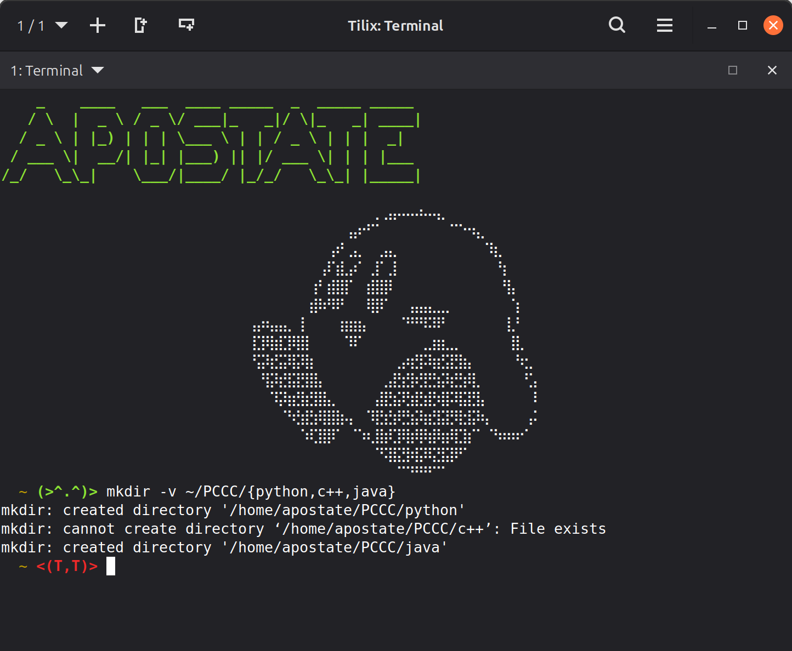
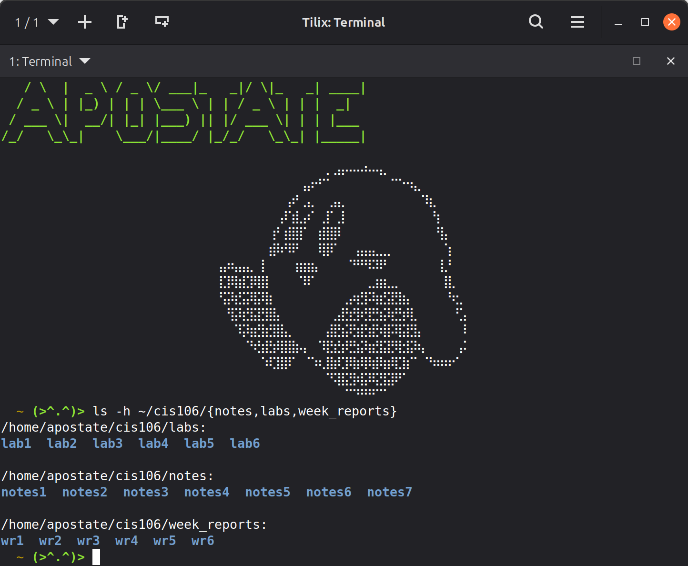

# Notes 7 Submission

## Wildcards

Wildcards are stand in symbols used for when a user doesnt know the entire file name or path name they are looking for. There are 3 different types of wildcards, all having different use cases and functions. Used in conjuction with other commands.

### The ```*``` Wildcard:

**Use-case:** The ```*``` is used to represent **any number** of characters. 

**Example:**

```bash
ls -h */notes
```
 In this example, I know the directory I am looking for is called **notes**, but lets assume I don't know where the directory is. The ```*``` can be used to substitute for an unknown path.

 ```bash
 ls -h ~/cis106/notes/*.jpg
 ```
In this example, I knew the path and location directory, but I dont know the name of the file. If I know its a **.jpg**, I can use ```*``` to substitute for the file name and show me all **.jpg's** in this directory.

### The ```?``` Wildcard:

**Use-Case:** The ```?``` is used to represent a **single** character, in the position it is placed. More then one can be used in a single command.

**Example:**

```bash
ls -h ~/cis106/notes/notes?.md
```
In this example, I want to list all of my **.md** files in my notes folder. This command would list **notes1.md** - **notes7.md**.

```bash
ls -h ~/cis106/notes/notes7.???
```
In this example, lets pretend I had several files of different types in the directory. This would list all files with 3 letter file types. (ie. **.exe, .jpg, .txt, .png, .exe**). Note that it *would not* provide two letter file types, such as **.md**.

### The ```[SET]``` Wildcard:

**Use-case:** The ```[SET]``` is used to represent a **single** character from an input **set** of characters.

**Example:**

```bash
ls -h ~/cis106/notes/notes[1-7]
```
In this example, the ```[1-7]``` would list all the notes files followed by the numbers 1 through 7. 

```bash
ls -h ~/cis106/notes/notes[1-9][1-9]
```
In this example, I want to find all of my notes that are followed by two digits. Since the ```[SET]``` wildcard only represents **one character**, we need to use two of them here for a 2 digit number.

## Brace Expansion:

Brace expansions are a very useful shortcut to make multiple directories or files in one command. Its helpful for setting up a directory tree, and can be used almost every Linux command.

**Example:**



In the above example, the brace expansion was used to create multiple directories within a specific directory, although one of them failed due to already existing.



In the above example, I used the brace expansions to ls the contents of multiple directories in one command.