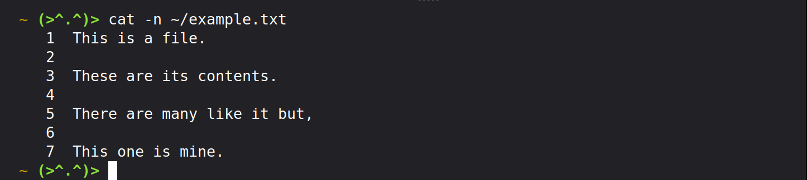
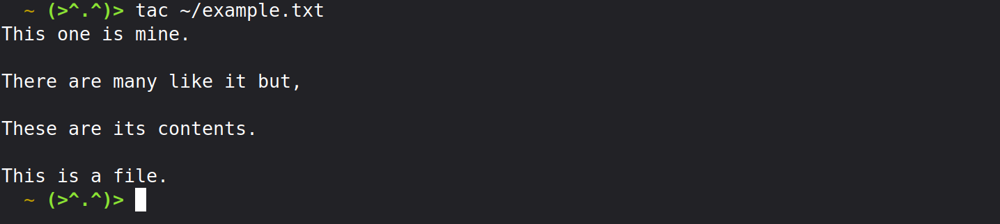
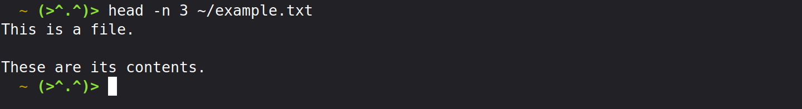
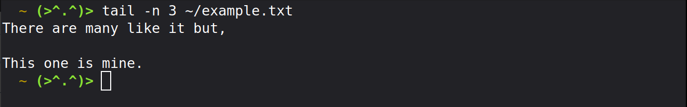
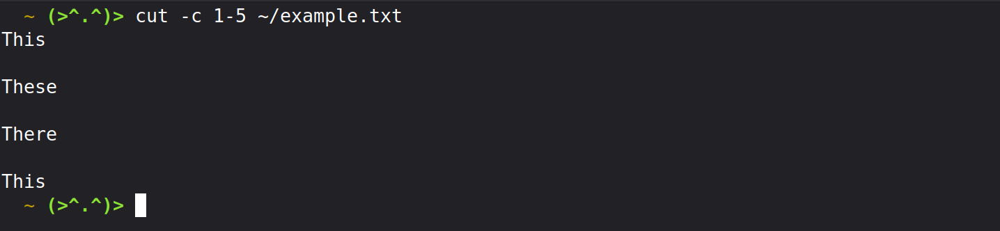
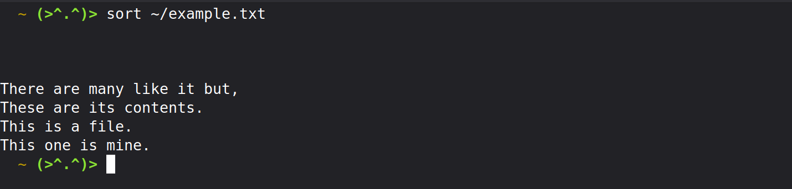
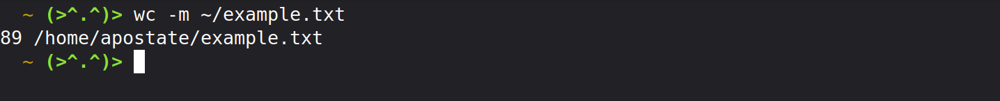

# Notes 8 Submission

## The ```cat``` Command

**Definition:**
The ```cat``` command is a linux command that lets the user display the contents of a file (or files) right in the terminal window.

**Usage/Formula:**

```bash
cat [option] [path/to/desired/file]
```
**Examples:**



*In this example, the ```-n``` option was used to display line numbers.*

## The ```tac``` Command

**Definition:**
The ```tac``` command functions much the same way the ```cat``` command does, with a slight variation. Rather then displaying the contents of the file, it displays the contents of the file in reverse, beginning with the last line and ending with the first line.

**Usage/Formula:**

```bash
tac [option] [path/to/desired/file]
```

**Examples:**



*In this example, no option was used.*

## The ```head``` Command

**Definition:**
The ```head``` command is a variation on the ```cat``` command. It allows you to see the first 10 lines of a file by default, or a different specified amount of lines.

**Usage/Formula:**

```bash
head [option] [path/to/desired/file]
```

**Examples:**



*In this example, the ```-n``` option was used in combination with '3' to display just the first 3 lines.*

## The ```tail``` Command

**Definition:**
The ```tail``` command is used in the same way as ```head```, only instead of the first 10 lines, it displays the last 10 lines. It can also have the default line count modified by a command to display a specific number of lines.

**Usage/Formula:**

```bash
tail [option] [path/to/desired/file]
```

**Examples:**



*In this example the ```-n``` command combined with '3' to display the final three lines.* 

## The ```cut``` Command

**Definition:**
The ```cut``` command is used similiarly to the previous commands, to display content of a file. However, ```cut``` requires the use of an option to specify what you are displaying, rather then just displaying lines. You can display content by number of:
* Characters
* Bytes
* Fields(columns)

**Usage/Formula**

```bash
cut [option] [qty] [path/to/desired/file]
```

**Examples:**



*In this example, the ```-c 1-5``` option tells the command to cut the first 5 characters of each line.*

## The ```sort``` Command

**Definition:**
The ```sort``` command will sort the contents of a file, line by line. You can sort alphabetically by default, or specify a different method of sorting via options.

**Usage/Formula:**

```bash
sort [option] [path/to/desired/file]
```

**Examples:**



*In this example, no option was used.*


## The ```wc``` Command

**Definition:**
The ```wc``` command is the word count command. By default it displays:
* Line Count
* Word Count
* Byte Count
But it can also be combined with options to display other information about a file.

**Usage/Formula:**

```bash
wc [option] [path/to/desired/file]
```

**Examples:**



*In this example, the ```-m``` is used to display just the character count.*
