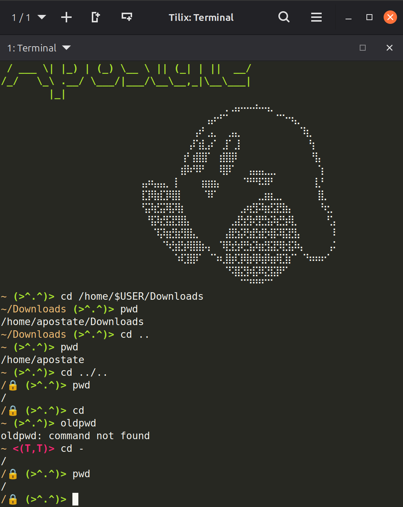
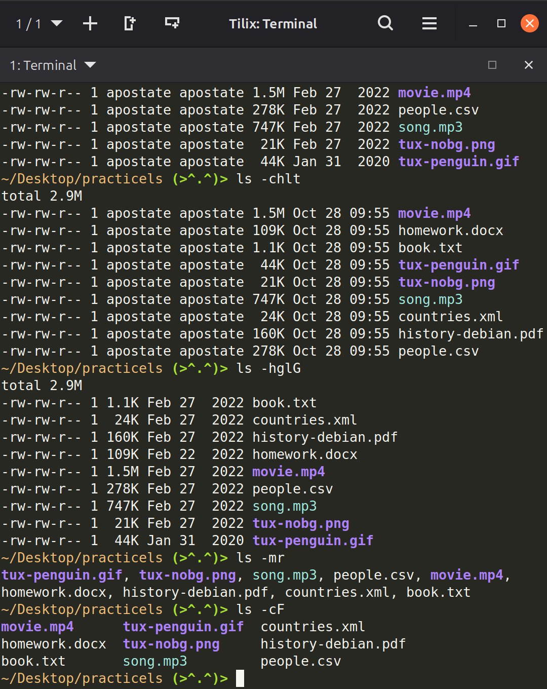
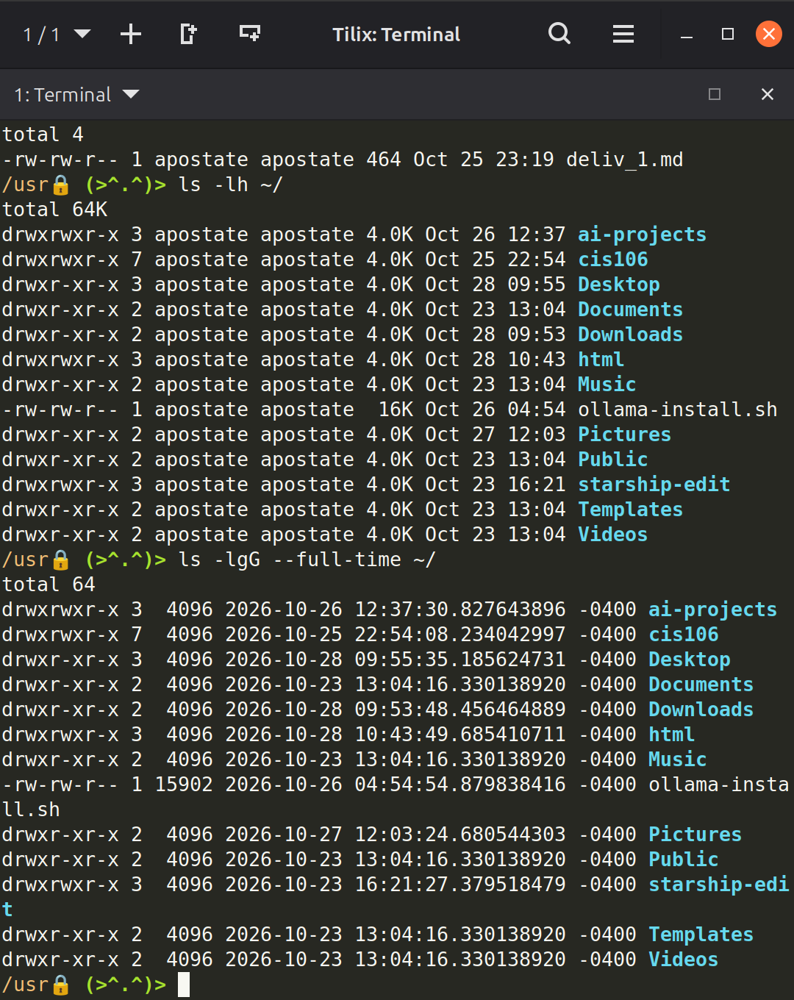
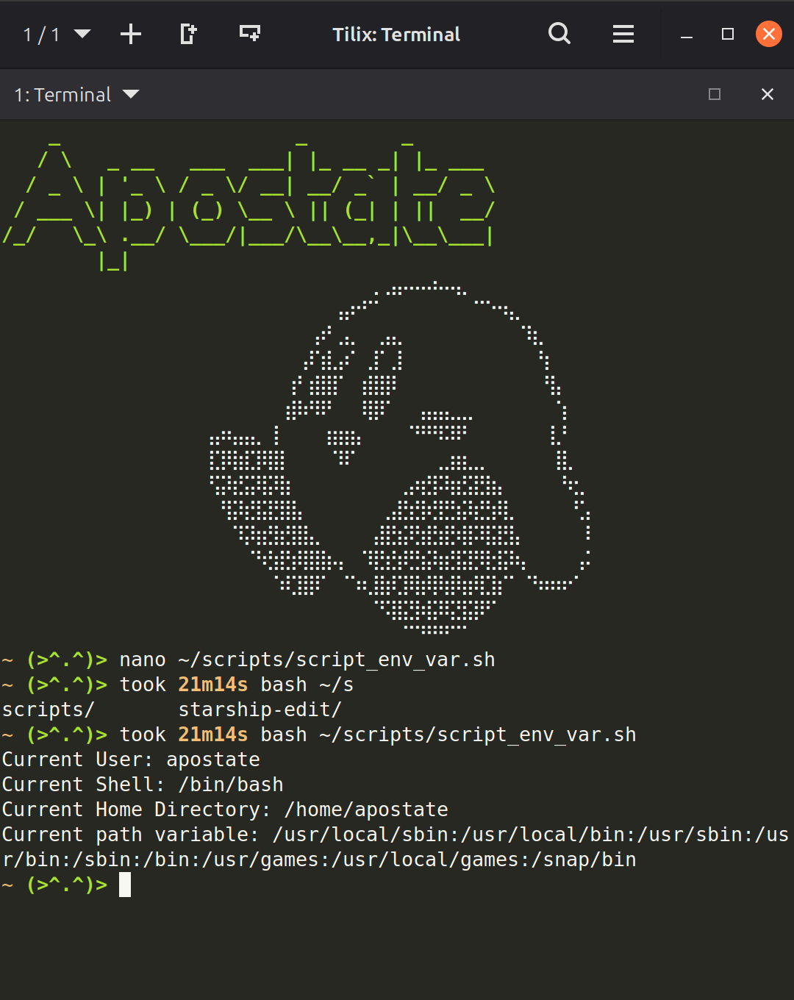
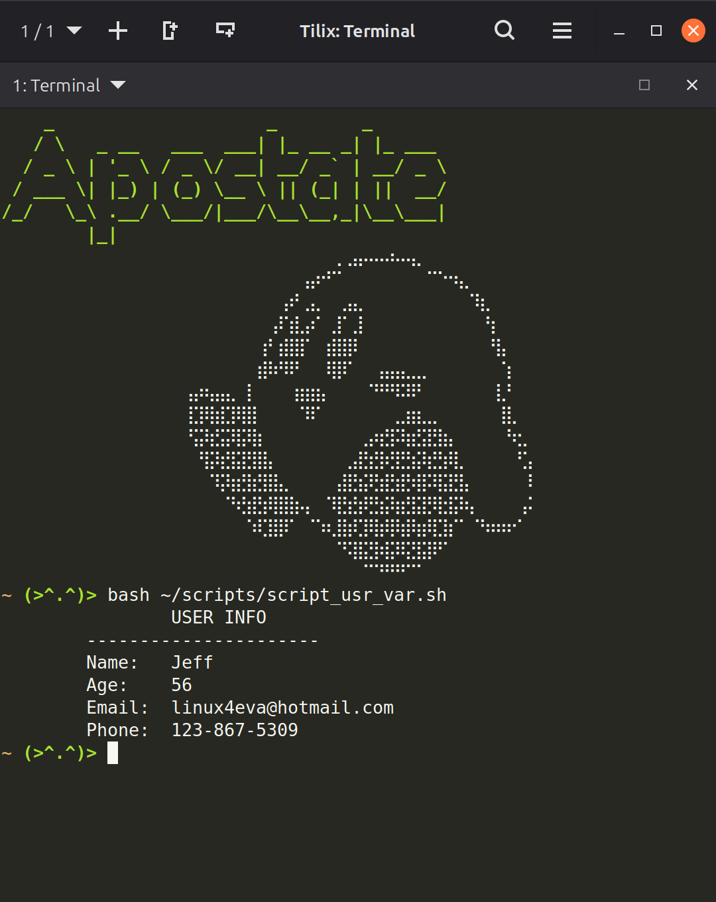

# Week Report 5 Submission

## Github Links

[Notes 5](https://github.com/mtschofield91/cis106/tree/main/notes/notes5)

[Lab 5](https://github.com/mtschofield91/cis106/tree/main/labs/lab5)

## Linux Filesystem Practice:

### Practice 1

### Practice 2

### Practice 3

## Shell Scripting Practice:

### Practice 1

### Practice 2

